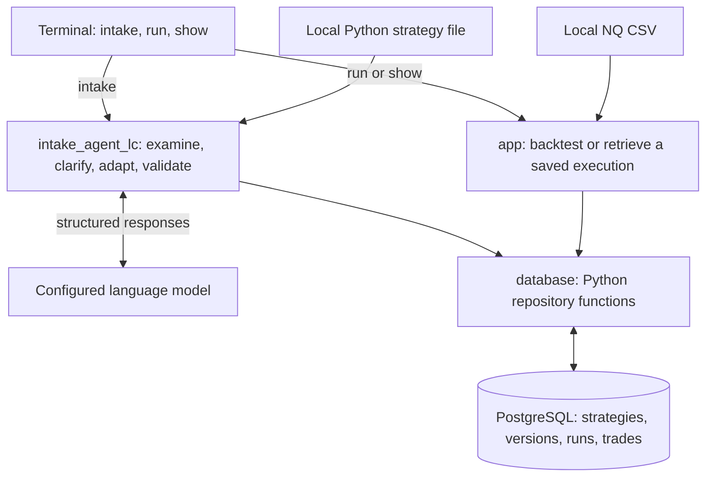

# NQ Strategy Backtester

This application was built to backtest or simulate trading strategies/algorithms written in Python against historical NASDAQ-100 futures data and keep the source code, settings, and results together in PostgreSQL.

The intake agent adapts existing strategy files for the engine through clarification, approval of required behavior changes, and static validation.

The terminal currently provides three commands: "intake" to adapt and save a strategy in PostgreSQL, "run" to backtest a saved strategy version, and "show" to retrieve a saved execution. The application runs one command per launch. After intake, backtesting, or result retrieval finishes, it returns to the terminal prompt. Run another command to continue using the application. There is currently no persistent menu

**This is an early version of the full scope of this project which is already large, many improvements and changes will be added, but for now this application does require some setup and specific configurations before use**

## Features

- Intake a local Python strategy file through a conversation that handles clarification, compatibility approval, and static validation before saving.
- Run a saved strategy version with configurable contract quantity and a fixed cost per completed trade.
- Calculate trade P&L, win rate, average trade, profit factor, and drawdown from completed trades.
- Validate CSV timestamps, OHLC prices, volume, contract codes, and session dates before execution.
- Retrieve saved executions with their strategy source, settings, trades, and metrics.
- Record execution status and save completed trades and metrics together in a database transaction, with dataset and engine file hashes for comparison between runs.
- Docker support soon.

## Architecture



- **[app](app/)** loads strategies and market data, executes the backtest, and calculates results. The engine owns positions, fills, costs, and completed trades.
- **[database](database/)** stores strategies, immutable source versions, runs, and trades. Its repositories handle SQL and transaction boundaries.
- **[intake_agent_lc](intake_agent_lc/)** contains the prompts, conversation state, routing, approval flow, deterministic static checks, and terminal pause and resume handling.

Intake saves a strategy for a later backtest. A backtest loads a stored version and the CSV, produces trades, calculates metrics, and saves the execution. Results can then be retrieved by run ID.

## Tech stack

- Python 3.14, PostgreSQL, and Psycopg 3.
- LangGraph, LangChain, langchain-openai, and Pydantic for intake.
- unittest and unittest.mock for testing, LangSmith for model evals.
- GitHub Actions for dependency checks and tests against a disposable PostgreSQL database.

Dependencies are pinned in [requirements.txt](requirements.txt). The CI environment is listed under Testing.

### Before you start

To follow the setup instructions below, you'll need:

- **Git** to clone the repository.
- **Python 3.14** to run the application.
- **PostgreSQL** running locally. The default connection uses `localhost:5432`, username `postgres`, and database `strategy_app_test`. Database creation and schema setup are covered below.
- **An OpenAI API key for intake.** After cloning, add it to a root `.envapi` file or set `OPENAI_API_KEY` in your terminal environment.
- **A local Python strategy file for intake.** The terminal asks for its path and any information needed to adapt it.
- **Historical data for backtesting.** Use a compatible CSV named `nq_active_1min_backtestingpy.csv` in the project root. Intake and retrieval do not need this file.

After cloning, install the packages from `requirements.txt` and complete the database setup below. Each command asks for your PostgreSQL password through a hidden terminal prompt.

#### Optional configuration changes

The application uses fixed defaults for the following settings. Using different values requires editing the source code:

- **Database host and port:** update the defaults in `database/connection.py`.
- **Database username:** update the connection call and password prompt in `app/Main.py`.
- **Database name:** update `TEST_DATABASE` in `app/Main.py`.
- **Model:** update the model passed to `init_chat_model()` in `intake_agent_lc/Workflow.py`.
- **CSV filename or location:** update `DATASET` in `app/Main.py`.

These settings currently have no CLI options or environment variable overrides. API credentials are configured separately using `.envapi` or the terminal environment.

## Getting started and usage

Use Python 3.14 and a local PostgreSQL server and take a look at the requirements file. The examples below use PowerShell.

Clone the main branch using these commands on powershell:

```powershell
git clone --branch main https://github.com/biggiechazza/Strategy_Creation_Backtesing_Deployment.git
cd Strategy_Creation_Backtesing_Deployment
```

Create an environment and install the dependencies from the project root.

```powershell
python -m venv .env1
& '.\.env1\Scripts\python.exe' -m pip install -r requirements.txt
```
Check if install succeeded:

```powershell
& '.\.env1\Scripts\python.exe' -m pip check
& '.\.env1\Scripts\python.exe' -m app.Main --help
```

### Set up the database

All three commands use PostgreSQL. In pgAdmin or another SQL client follow these instructions:

1. Create an empty database named `strategy_app_test`.
2. Connect the query tool to that database and run [postgres_schema.sql](database/sql/postgres_schema.sql) once. It creates all four tables and is an alternative to running the individual table scripts.
3. Keep the PostgreSQL server running while using the application.

The CLI connects to `localhost:5432` as `postgres` and asks for the password without displaying it. It checks the actual database name before handling any command.

### Intake a strategy

Intake needs the database, model credentials, and a local UTF8 Python strategy file. It does not need the historical CSV.

Create a file named '.envapi' in the project root containing:

```dotenv
OPENAI_API_KEY = your_api_key_here
```

Replace the placeholder with your own key. The saved workflow explicitly loads this file, which is ignored by Git. It currently configures `gpt-6-luna`, so the key needs access to that model. Intake uses live model calls. The `run` and `show` commands do not initialize the model or require this key.

Start intake from the project root:

```powershell
& '.\.env1\Scripts\python.exe' -m app.Main intake
```

1. Enter the path to your Python strategy file.
2. Answer any clarification questions. If compatibility changes are proposed, review them and enter exactly `approve all` to approve every change, or `reject` to stop.
3. After static validation passes, enter a unique strategy name and an optional description.
4. A successful save prints a **strategy ID** and **strategy version ID**. Keep the version ID for the backtest command.

Intake creates a new strategy and its initial version 1 together. If the name is taken, it asks for another name. It does not append a version to an existing strategy.

### Run a backtest

Backtesting needs the database, a trusted saved strategy version, and a compatible CSV. You can use the version ID returned by intake or an existing version in your database.

Put `nq_active_1min_backtestingpy.csv` in the project root with these case sensitive columns:

```text
Date,Open,High,Low,Close,Volume,contract,trade_date
```

Prices must be positive, finite, and aligned to the 0.25 point NQ tick. Timestamps must be in order without duplicates, and contract codes must use the quarterly NQ format, such as `NQM4` or `NQH25`. The loader preserves the supplied timestamp offset and futures session date.

Strategy and market data inputs are not currently shipped as runnable examples.

Run from the project root and enter the saved **strategy version ID** when prompted:

```powershell
$versionId = Read-Host 'Strategy version ID'
& '.\.env1\Scripts\python.exe' -m app.Main run $versionId --quantity 1 --cost-points 2
```

Quantity defaults to 1 and supports integers from 1 through 10. `--cost-points` is required, including when choosing `0`. A value of `2` charges a fixed `$40` per completed trade, without scaling by quantity.

The command prints the run ID, completed trade count, and net P&L. Keep the **run ID** for retrieval.

### Retrieve a saved execution

Retrieval needs only the database and a saved run ID. It does not need the CSV, original strategy file, or model credentials.

```powershell
$runId = Read-Host 'Run ID'
& '.\.env1\Scripts\python.exe' -m app.Main show $runId
```

`show` prints the saved record, including the strategy source, settings, status, metrics, and ordered trades. A strategy version ID selects what to test. A run ID selects one execution of that version.


### Returning to the application

Once initial setup is complete, open PowerShell and navigate to your existing project folder. **Replace the example path below with the location where you cloned the repository**:

```powershell
Set-Location -LiteralPath 'C:\path\to\Strategy_Creation_Backtesing_Deployment'
```

Ensure your local PostgreSQL server is running. To start strategy intake using the existing Python environment:

```powershell
& '.\.env1\Scripts\python.exe' -m app.Main intake
```

Enter your PostgreSQL password when prompted. Password input is hidden. The application then asks for the path to your Python strategy file.

These steps assume your `.env1` environment and API credentials are already configured. Use the `run` and `show` commands documented above to backtest a saved strategy version or retrieve an existing run.

### Some usage notes

- **Strategy file input:** Paste the full file path without surrounding quotes. The strategy must be a `.py` file saved as UTF-8 without a byte order mark (BOM).

- **Saved strategy code:** Backtests execute the strategy source stored in PostgreSQL. Editing the original Python file does not update that saved source. To test revised code, complete another intake using a new, unique strategy name.

- **Keep your IDs:** Save the strategy version ID returned by intake and the run ID returned by a backtest. The CLI currently has no command to list saved strategies or run history. IDs can also be looked up directly in PostgreSQL.

- **Backtest scope and progress:** Each backtest processes the entire configured CSV. There is no date-range selection or progress indicator. After the initial “Started run” message, large datasets may take time before another message appears.

- **Result display:** The `show` command prints a detailed terminal record, including strategy source, settings, metrics, and trades. There are currently no built-in charts, formatted reports, or export commands.

- **Metric values:** Win rate is stored as a fraction, so `0.6` means 60%. Profit factor is `None` when there are no losing trades, including when no trades were completed.

## Testing

On November 12, 2026, [this GitHub Actions run](https://github.com/biggiechazza/Strategy_Creation_Backtesing_Deployment/actions/runs/43268528683) passed **133 tests with no skips** for [commit d8cde9b](https://github.com/biggiechazza/Strategy_Creation_Backtesing_Deployment/commit/d8cde9bba1ba85af1316a0a89e09dd83e87f6e8c). The environment used Ubuntu 24.04, Python 3.14.10, and PostgreSQL 18.6. Dependencies were installed from `requirements.txt`, checked with `pip check`, and imported before the schema and tests ran.

- **Application tests** cover data validation, strategy loading, execution rules, rollover behavior, costs, metrics, CLI behavior, and repository transactions.
- **Four live PostgreSQL tests** check committed records through new connections, rollback of partial completion results, failed run status, and use of the public schema.
- **Intake tests** use mocked model responses and repository calls to check pauses and resumes, clarification, compatibility approval, validation correction, duplicate names, and save errors. They do not demonstrate a live model conversation saving to PostgreSQL.

For full local discovery:

```powershell
& '.\.env1\Scripts\python.exe' -B -m unittest discover -s tests -v
```

For a focused engine check:

```powershell
& '.\.env1\Scripts\python.exe' -B -m unittest discover -s tests -p test_engine.py -v
```

Local live database tests skip when `STRATEGY_APP_TEST_DB_PASSWORD` is unset. If supplied, they connect to `strategy_app_test`, create test rows, and attempt cleanup of their own rows afterward. CI supplies this variable for its disposable database and fails if any tests are skipped. Intake tests mock model setup and do not require an API key.

## Engineering decisions and limitations

**Keep execution rules independent of model responses.** The models help adapt strategy source. Trading calculations, validation rules, and SQL stay in ordinary application code so their behavior can be inspected and tested directly.

**Keep related writes together.** Intake saves the new strategy and version 1 in one transaction. Backtests record a running execution before loading the strategy or dataset, then save completed trades and metrics together. If that completion transaction fails before commit, its changes roll back together. Failure status is recorded separately when possible.

**Preserve the context behind a result.** Runs reference immutable strategy source versions. Dataset hashes identify the CSV bytes read during loading. Engine hashes cover the names and bytes of `data_loader.py`, `engine.py`, `metrics.py`, and `models.py`. Reproducing a result also requires the matching source version, settings, data, and environment.

The current v1 limits are:

- **Intake and source trust.** Validation inspects source without executing the submitted strategy. Passing static checks does not establish runtime correctness, faithful trading behavior, profitability, or execution safety. Backtests execute stored Python in the application process without a sandbox, so that source must be trusted.
- **Execution and metrics.** The engine holds one position and fills at completed bar closes. Contract changes reset the strategy and history and discard an open trade spanning the change. Any position remaining at the end closes at the final bar close. Drawdown uses completed trade net P&L and does not measure unrealized movement inside an open trade.
- **Conversation and recovery.** Intake checkpoints last only within the current process, with one intake per program launch. Durable conversation recovery, automatic recovery after a hard process kill, and reconciliation of uncertain intake commit outcomes remain unfinished. Check the DB before retrying an unconfirmed save.
- **Configuration and versions.** The CSV filename and test DB target are fixed. Intake creates new strategies with version 1, and the CLI does not append versions to an existing strategy.

## Further documentation

Dependencies: [requirements.txt](requirements.txt).

## Project links

- Maintainer:  Zachary Guzman (https://github.com/biggiechazza) (https://www.linkedin.com/in/zachary-guzman/)
- Repository: [Strategy Creation, Backtesting, and Deployment](https://github.com/biggiechazza/Strategy_Creation_Backtesing_Deployment)
- Questions or feedback: [Open an issue](https://github.com/biggiechazza/Strategy_Creation_Backtesing_Deployment/issues) or zguzman5742@gmail.com